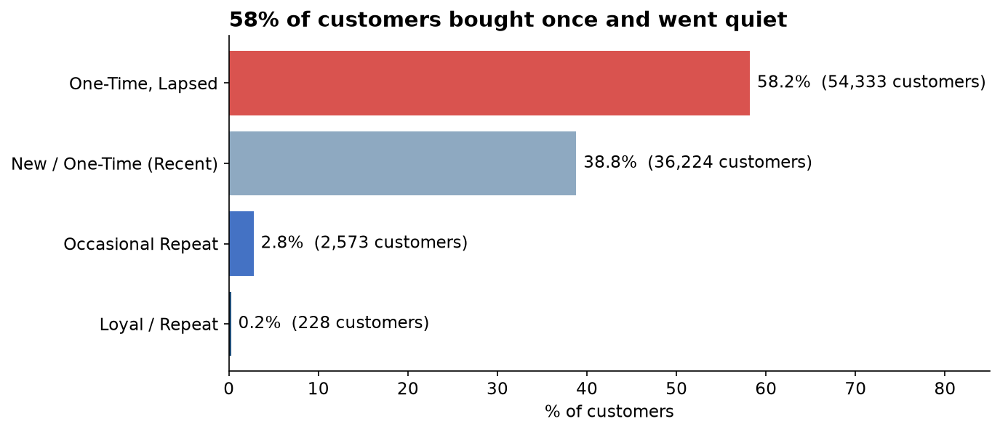
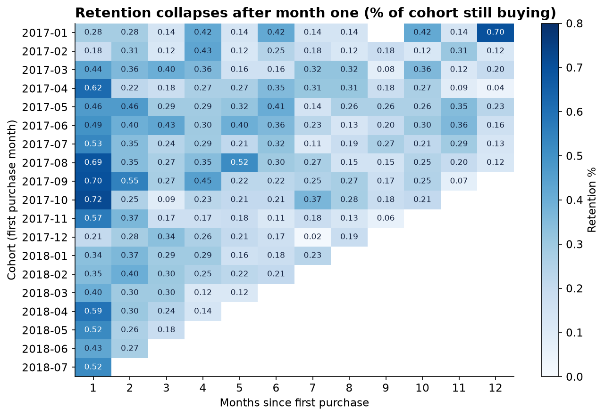
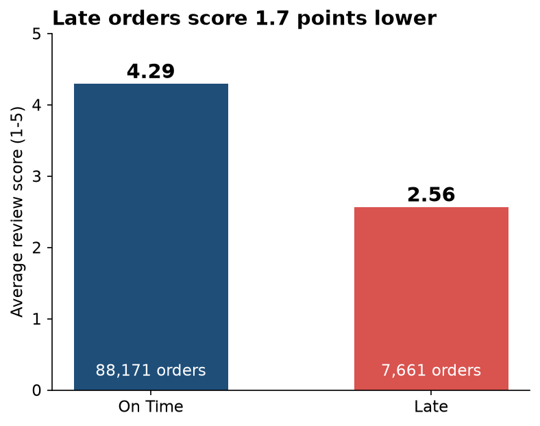
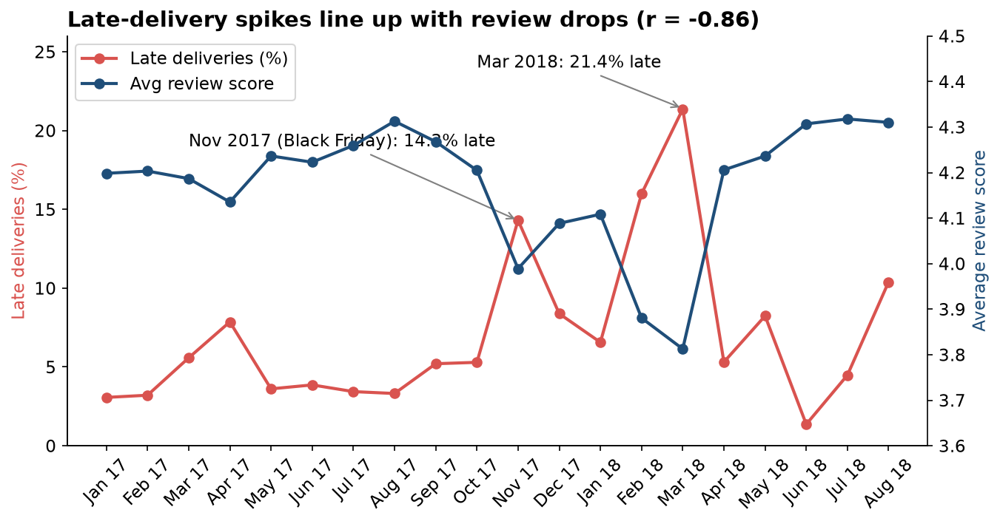
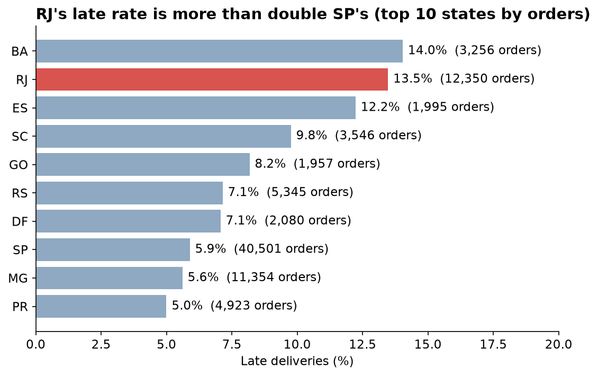

# Olist E-Commerce: Customer Retention & Delivery Analysis

An end-to-end analysis of 96,478 delivered orders from Olist, a Brazilian online marketplace (Sep 2016 to Aug 2018). The project asks one business question: **which customers should the business try to keep, and what is stopping them from coming back?**

**Live dashboard:** [View on Tableau Public](YOUR_TABLEAU_PUBLIC_LINK)

## Key findings

| Finding | Value |
|---|---|
| Customers who bought only once | 97.0% (90,557 of 93,358) |
| Customers who bought again | 3.00% |
| Month-1 retention (size-weighted) | 0.48%, flattening to about 0.2-0.3% from month 3 |
| Customer segments | 58.2% lapsed one-time, 38.8% recent one-time, 2.76% occasional repeat, 0.24% loyal (228 customers) |
| Loyal customers' average spend | R$506.79 vs about R$160 for one-time buyers |
| Orders delivered late (vs Olist's own estimate) | 8.11% |
| Review score, on-time vs late | 4.29 vs 2.57 (difference 1.73, 95% CI 1.69 to 1.77, Cohen's d = 1.45) |
| Monthly late-delivery % vs average review score | r = -0.86 across 20 months with 500+ orders |
| Worst month | Mar 2018: 21.4% late, 3.81 average review |
| Largest problem state | RJ: 12,350 orders, 13.5% late (SP: 5.9%) |

## Visuals

### Most customers buy once and never return

58.2% of customers bought once and have gone quiet. Only 228 customers (0.24%) qualify as loyal repeat buyers, and they spend about three times as much per person.



### Retention collapses after the first month

Each row is a group of customers by month of first purchase. Fewer than 1% come back in any later month, and the pattern is the same for every cohort.



### Late deliveries score 1.7 points lower

Orders that arrived after Olist's estimate average 2.57 stars. On-time orders average 4.29.



### Late-delivery spikes line up with review drops

The two worst months for late deliveries, Nov 2017 (Black Friday volume) and Mar 2018, are also the two worst months for review scores. Months with fewer than 500 orders are excluded so that single-order months do not distort the correlation.



### Rio de Janeiro has the biggest delivery problem

RJ is the second-largest state by order volume and its late rate is more than double that of Sao Paulo.



## Recommendation

Retention is close to zero, and late delivery is strongly associated with low review scores. Improving delivery reliability looks like a higher-value retention lever than loyalty or acquisition spend. Start with Rio de Janeiro (large volume, more than double the late rate of Sao Paulo) and prepare for volume spikes like Black Friday 2017, when the late rate hit 14.3%.

## Approach

1. **Data audit** (`01_data_profiling.ipynb`): profiled all 9 tables for nulls, key integrity, date logic, encoding, and category coverage.
2. **Cleaning** (`02_data_cleaning.ipynb`): parsed dates, kept delivered orders only, attached `customer_unique_id`, flagged zero-value payments, mapped untranslated categories, aggregated geolocation to one row per zip prefix.
3. **Statistics** (`03_statistics.ipynb`): RFM segmentation, monthly cohort retention, and a Welch's t-test with Cohen's d and a confidence interval for late vs on-time reviews.
4. **Visualization prep** (`04_visualization_prep.ipynb`): aggregated exports for Tableau Public, which cannot connect to a live database.
5. **Findings summary** (`05_findings_summary.ipynb`): consolidated results and the data issues log.
6. **README charts** (`06_readme_charts.ipynb`): the static charts shown above, generated from the exports.
7. **Dashboard**: Tableau Public, built from the CSVs in `exports/`.

## Data issues found and fixed

| # | Issue | Resolution |
|---|---|---|
| 1 | `customer_id` is per order, not per person | Used `customer_unique_id` for all customer-level work |
| 2 | 3% of orders were not delivered | Filtered to delivered orders |
| 3 | 9 zero-value payment rows | Traced to voucher splits and `not_defined` types; excluded from value math |
| 4 | 2 product categories without an English translation | Mapped manually |
| 5 | About 52 geolocation rows per zip prefix with coordinate spread | Aggregated to median lat/lng |
| 6 | 1 order with no payment record | Treated as zero revenue and documented |
| 7 | Unweighted cohort average overstated month-1 retention (5.45% vs 0.48%) because of a 1-customer cohort | Rebuilt as total retained divided by total eligible |
| 8 | 551 duplicate review rows inflated the t-test sample | Kept the latest review per order |
| 9 | Monthly correlation was inflated by three sparse months (1, 265 and 1 orders) | Recomputed on months with 500+ orders (r = -0.97 became about -0.86) |

## Limitations

- The late vs on-time comparison is observational, not a randomized experiment. It shows a strong association, not proof that lateness alone causes low reviews.
- "Late" is measured against Olist's own delivery estimate.
- Repeat purchase depends on `customer_unique_id` tracking the same person across orders. Customers who use different accounts would be undercounted.
- Revenue is payment value in Brazilian reais (R$) and includes freight.
- The data ends in 2018, so recent cohorts have little follow-up time.

## Repository structure

```
data/raw/          Kaggle CSVs (not committed, see below)
data/processed/    Cleaned tables (not committed)
notebooks/         01 profiling, 02 cleaning, 03 statistics, 04 visualization prep, 05 findings, 06 README charts
exports/           Aggregated CSVs used by the Tableau dashboard
outputs/           Chart images used in this README
```

## Reproduce it

1. Clone the repo: `git clone https://github.com/kimenjuivy/Olist-customer-retention-and-delivery-analysis.git`
2. Download the [Olist Brazilian E-Commerce dataset](https://www.kaggle.com/datasets/olistbr/brazilian-ecommerce) from Kaggle and place the 9 CSVs in `data/raw/`.
3. `pip install -r requirements.txt`
4. Run the notebooks in order, 01 through 06.

## Tools

Python, pandas, NumPy, SciPy, Matplotlib, Jupyter, VS Code, Tableau Public
